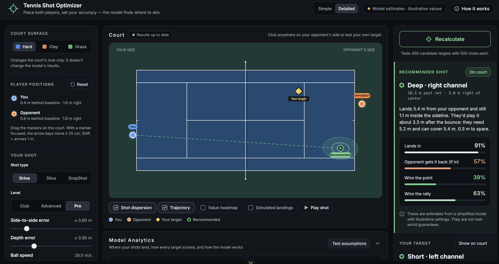
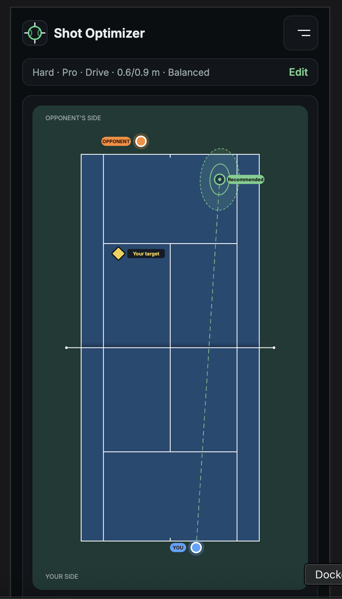
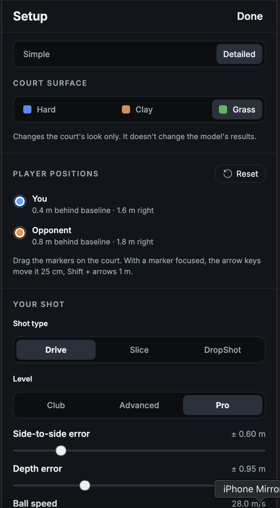
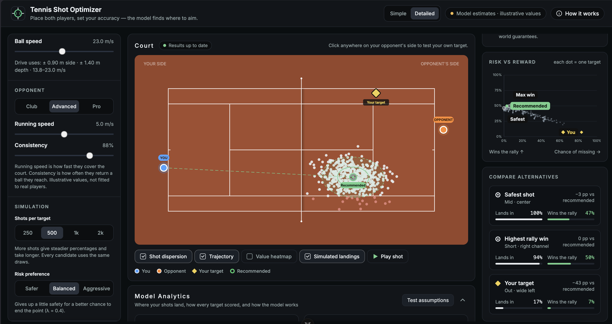
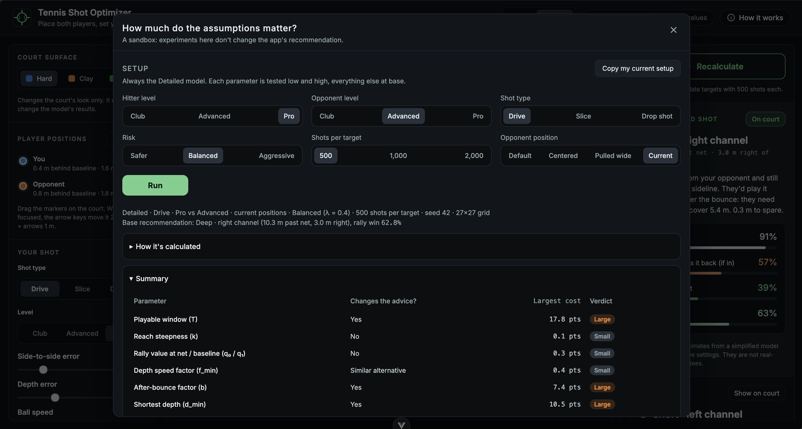

# Tennis Shot Optimizer

**Where should you aim your next shot?** Set up a point — where you and your
opponent stand, how accurate you are, how fast they run — and the app simulates
thousands of shots to every spot on the court and recommends the best target.

**[Live demo →](https://YOUR-SITE.netlify.app)**



> **Note:** this is a model, not a coach. It uses simple physics and probability
> with illustrative values that are not fitted to real match data. It shows how
> accuracy, speed, position and risk trade off against each other, not what a
> real player would do. See [docs/model-notes.md](docs/model-notes.md) for every
> simplification.

## What it does

Aiming close to the lines makes a shot harder to return, but also more likely to
miss. The app puts numbers on that trade-off:

1. **Aim:** it tries every target on a 27 × 27 grid over the opponent's court.
2. **Scatter:** for each target it simulates hundreds or thousands of shots that
   miss the aim by a random amount, based on your side-to-side and depth error.
3. **Chase:** for every shot that lands in, it estimates whether the opponent can
   run to the ball in time, from their position and running speed.
4. **Score:** it combines the chance of landing in, the chance of a winner and
   your risk preference into one score, and recommends the target with the
   best score.

## Features

- **Interactive court:** drag both players, click anywhere on the opponent's side
  to test your own target, and watch the shot play out in an animation.
- **Your shot and your opponent:** Club, Advanced and Pro presets, or fine-tune
  side error, depth error, ball speed, running speed and consistency.
- **Risk preference:** Safer, Balanced or Aggressive changes how much a missed
  shot is penalized.
- **Two models:**
  - **Simple:** the opponent has to reach the landing point; a shot that isn't
    returned is a winner.
  - **Detailed:** adds shot types (Drive, Slice, Drop shot), the bounce (the
    opponent can play the ball after it bounces), slower balls for shorter
    targets, and rally value (a returned ball isn't a lost point).
- **Results:** chance of landing in, of hitting a winner and of winning the
  rally, with the safest target and the highest-winning target to compare against.
- **Court overlays:** shot scatter, trajectory, a value heatmap of every target,
  and the simulated landings.
- **Model analytics:** where your shots land, a value map of every target,
  details of the last simulation run, and an explanation of how the model works.
- **Test assumptions:** a sandbox that changes each model guess and player input
  up and down, reruns the search, and shows how much the recommendation depends
  on it. Includes every formula used, with an explanation of each symbol.
- **Responsive:** a three-column layout on desktop, a court-first layout with a
  setup sheet on phones and tablets, and keyboard access.

<p align="center">
  
  &nbsp;&nbsp;
  
</p>

## How to use it

1. **Set up the point** in the left sidebar: court surface, your level and shot
   type, your opponent's level, and your risk preference. Drag the two players
   on the court, or use **Reset** to return them to their default positions.
2. **Calculate.** The recommendation updates automatically when you change a
   preset. After dragging a player or moving a slider, click **Recalculate**.
3. **Read the result** in the right sidebar: the recommended target, its chances,
   and **Compare alternatives** to see the safest shot and the shot that wins
   most often. Use **Show on court** to see any of them on the court.
4. **Test your own idea:** click a spot on the opponent's side. The sidebar
   shows **Your target** next to the **Recommended shot**, so you can compare them.
5. **Explore:** turn on the heatmap or simulated landings below the court, and
   open **Model analytics** for the full picture.



6. **Check how solid the advice is:** in Model analytics, click
   **Test assumptions**. Pick a setup, press **Run**, and see which parameters
   change the recommendation and how many points per 100 shots it costs to ignore them.



## Getting started

Requires **Node.js 22.18+ or 24.12+**.

```sh
git clone https://github.com/lizikaviladze14/tennis-shot-optimizer.git
cd tennis-shot-optimizer
npm install
npm run dev
```

Then open the local URL Vite prints (usually http://localhost:5173).

### Scripts

| Command | What it does |
| :-- | :-- |
| `npm run dev` | Start the dev server with hot reload |
| `npm run build` | Type-check and build for production into `dist/` |
| `npm run preview` | Serve the production build locally |
| `npm run test:unit` | Run the unit tests (Vitest) |
| `npm run type-check` | Type-check with `vue-tsc` |
| `npm run lint` | Lint with oxlint and ESLint |
| `npx vite-node scripts/sensitivity.ts` | Rerun the sensitivity analysis and regenerate [docs/sensitivity-results.md](docs/sensitivity-results.md) |

## How the model works

The full reasoning, with every simplification, is in
[docs/model-notes.md](docs/model-notes.md). In short:

- **Landing:** each simulated shot lands at the aim plus a normally distributed
  miss along the shot (depth error) and across it (side error). Every target is
  tested with the same random draws, so targets are compared fairly.
- **Reaching the ball:** the opponent's margin is the distance they still have
  to run when the ball arrives. A smooth curve turns that margin into a chance of
  reaching the ball, and their consistency into a chance of returning it.
- **Score:** `P(rally win) − λ · P(miss)`, where λ comes from the risk
  preference (Aggressive 0, Balanced 0.4, Safer 1). The search recommends the
  target with the highest score.

[docs/sensitivity.md](docs/sensitivity.md) explains which of the illustrative
parameters actually change the advice, with generated results in
[docs/sensitivity-results.md](docs/sensitivity-results.md).

## Project structure

```
src/
  math/          the model: pure functions, no Vue, no DOM
  analysis/      scenario builder and sensitivity analysis, built on the model
  animation/     ball path geometry for the shot animation
  components/    Vue components (court, sidebars, analytics, dialogs)
  composables/   reusable Vue logic (shot animation)
  workers/       web workers that run the search off the main thread
  types/         presets: shot accuracy, opponent skill, shot types, risk
  utils/         UI wording and formatting
scripts/         Node scripts (sensitivity analysis)
docs/            model notes and sensitivity analysis
```

## Tech stack

Vue 3 · TypeScript · Vite · Vitest · Web Workers · SCSS
